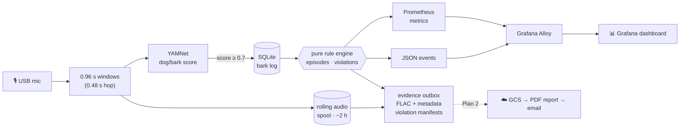

<div align="center">

# 🐕‍🦺 chase

**A neighborhood barking monitor that turns "the dogs barked all night again" into evidence.**

*No job's too big, no pup's too loud.*

[](https://github.com/benjaminmikiten/chase/actions/workflows/ci.yml)


</div>

---

`chase` listens through a USB microphone, recognizes dog barking with Google's
[YAMNet](https://www.kaggle.com/models/google/yamnet) audio model, and charts it on a Grafana
dashboard. When the barking crosses a configurable noise-ordinance threshold, it keeps the
recordings and builds the case for you: timestamps, durations, fingerprinted audio, and (soon) a
ready-to-forward complaint ([sample PDF](docs/samples/sample-report.pdf), synthetic data).

City animal services usually want **recordings of repeated, sustained barking**, not a
neighbor's impression of it. Getting those by hand means being awake, home, and holding a phone at
exactly the wrong moments. `chase` does it all day, every day, on a spare computer.

## What it does

- 🎙️ **Listens continuously** on a USB mic and scores every ~1 s of audio for dog sounds (bark,
  yip, howl, growl…).
- 📈 **Shows the pattern** on a Grafana dashboard: barking right now, bursts this hour against
  normal, today against the 30-day average, an hour × weekday heatmap, and a timeline.
- ⚖️ **Applies your city's rule.** It turns raw detections into **episodes** (sustained barking)
  and **violations** (repeated episodes). Every threshold is config, and you can replay new
  thresholds over your real history before switching to them.
- 🗂️ **Keeps evidence, not surveillance.** Audio leaves the rolling buffer only when it's part of
  an episode. Each clip gets 30 s of context on either side, a SHA-256 fingerprint, and an honest
  record of any gaps.
- 🛡️ **Survives real life.** Restarts, power blips, unplugged mics, and a drifting mic clock
  don't lose, duplicate, or mis-time anything.

## Status

| | What | State |
|---|---|---|
| **Plan 1** | Listener, rules, local evidence outbox, Grafana dashboard, Docker deployment | ✅ running on real hardware |
| **Plan 2** | Upload evidence to Google Cloud Storage; generate the complaint letter + evidence-packet PDF; email it to you, ready to forward; alerting | 🔧 built, needs one-time cloud setup ([infra/README.md](infra/README.md)) |
| **v2** | "Which dog is this?" classifier trained on locally kept clips | 🗓️ later |

## How it works



Everything runs in two containers (`listener` and `alloy`) under Docker Compose. The cloud side in
Plan 2 scales to zero, so it costs nothing while the dogs are quiet.

## The rules

Three ideas, all set in config:

| Term | Default (San Antonio preset) | Meaning |
|---|---|---|
| **Barking window** | YAMNet score ≥ **0.7** | ~1 s of audio that sounds like a dog |
| **Episode** | ≥ **10 min** of barking, no gap > **30 s** | Sustained barking. Episodes less than **10 min** apart merge into one, so a short pause can't turn one bout into two "separate" events. |
| **Violation** | ≥ **2 episodes** within **24 h** | Repeated sustained barking: what the city cares about |

```
  06:40        06:58                        22:15                 22:41
    |██████▌█████|            …              |███████▌████████▌█████|
    └ episode 1: 18 min ┘                    └──── episode 2: 26 min ────┘
                                                                  ▲
                                         2 episodes within 24 h → violation
  (▌ = a short pause under 30 s: still the same episode)
```

**Tune before you trust.** Thresholds are a judgment call, so `chase replay` re-runs the rules
over everything logged so far, with any preset, without touching anything:

```bash
make replay SINCE=2026-11-01                                  # current rules
make replay PRESET=config/presets/my-stricter-city.yaml       # what-if
```

> [!NOTE]
> The "bark count" is an estimate of **barking bursts**, not individual barks. Overlapping
> one-second windows blur barks that come about a second apart, so **barking minutes** is the
> headline number ([ADR 0002](docs/adr/0002-bark-count-is-burst-count.md),
> [#13](https://github.com/benjaminmikiten/chase/issues/13)).

## Quick start

**You need:** a Linux machine that's always on (an old desktop is plenty), Docker with the
Compose plugin, a USB microphone, and a Grafana Cloud account (the free tier works).

```bash
git clone https://github.com/benjaminmikiten/chase.git && cd chase

arecord -l                                   # find your mic, e.g. "TONOR G11 USB mic"
cp config/chase.example.yaml config/chase.yaml
$EDITOR config/chase.yaml                    # audio_device: TONOR   (part of the mic's name)

make up                                      # build and start
make watch                                   # live metrics; play a dog-bark video near the mic
```

When `chase_barking_windows_total` climbs, it's working. To ship metrics and events to Grafana,
fill in `.env` (copy `.env.example`; the Loki URL must end in `/loki/api/v1/push`), run
`make up` again, and import [`grafana/dashboard.json`](grafana/dashboard.json).

The full walkthrough covers clock sync, the host audio group, the dashboard, and auto-updates:
**[docs/running-on-the-optiplex.md](docs/running-on-the-optiplex.md)**.

## Configuration

`config/chase.yaml` is git-ignored, so your settings stay local:

```yaml
rules:
  preset: san-antonio        # any file in config/presets/, without .yaml
  # max_gap_seconds: 45      # override any rule key here
  # min_loudness_dbfs: -35   # optional: ignore distant/quiet barking

audio_device: TONOR          # required: part of the mic's name
capture_rate: 48000          # multiple of 16000
timezone: America/Chicago
```

**Add your city** by copying [`config/presets/san-antonio.yaml`](config/presets/san-antonio.yaml).
A preset carries the thresholds plus the citation, caveat, and addressee text the report prints.
Typos fail loudly at startup: unknown keys and out-of-range values are rejected, never silently
ignored.

## Evidence and privacy

| Where (on the `chase-data` volume) | What | Leaves the machine? |
|---|---|---|
| `chase.sqlite` | the bark log: timestamps, scores, loudness (no audio) | no |
| `spool/` | the last ~2 h of audio in 1-minute FLAC segments, continuously overwritten | no |
| `outbox/episodes/<id>/` | episode audio (FLAC, 30 s pre/post-roll) + `metadata.json` | Plan 2 uploads it |
| `outbox/violations/<id>/rev-N.json` | which episodes make up a violation, plus the rule applied | Plan 2 uploads it |
| `backlog/YYYY-MM-DD/` | one ≤5 s clip per barking burst, kept 90 days, for training v2 | no |

Principles the code enforces:

- **Audio leaves the rolling buffer only as part of an episode.** Everything else is overwritten.
- **Evidence is tamper-evident.** Every clip's SHA-256 goes into its metadata (and, in Plan 2,
  into the report).
- **Silence is never passed off as recorded audio.** If a restart or unreadable file left a hole,
  the clip's metadata lists it (`audio.gaps`, `audio.complete: false`).
- **No claims it can't back up.** v1 can't tell dogs apart, so reports say "barking from
  neighboring properties" and never pin it on one house.
- **Nothing personal in this repo.** Addresses, emails, recordings, and credentials live in
  git-ignored config or a secret manager.

## Dashboard and metrics

The dashboard ([`grafana/dashboard.json`](grafana/dashboard.json)) has:
- a top row of stats: barking right now (and time until it counts), bursts this hour against
  normal, today against the 30-day average, and episodes in the current window;
- bursts per hour over 24 h, with the hourly average overlaid;
- a recent-episodes table, a timeline of today, and an hour × weekday heatmap.

The 30-day baselines are computed on the box itself, so they work even on Grafana Cloud's free
tier, which keeps about 14 days.

| Metric | Meaning |
|---|---|
| `chase_barking_windows_total`, `chase_barks_total` | barking windows; estimated barking bursts |
| `chase_current_run_seconds`, `chase_seconds_until_episode`, `chase_barking_now`, `chase_in_episode` | barking in progress |
| `chase_episodes_total`, `chase_violations_total`, `chase_episodes_in_window` | rule outcomes |
| `chase_barks_this_hour`, `chase_typical_barks_this_hour`, `chase_barks_today`, `chase_daily_average_barks`, `chase_heatmap_barks` | 30-day baselines |
| `chase_heartbeat_timestamp_seconds`, `chase_last_tick_success_timestamp_seconds` | liveness (heartbeat stops if the mic or model fails) |
| `chase_audio_errors_total{reason}`, `chase_clock_corrections_total`, `chase_outbox_pending`, `chase_data_free_bytes` | health |

## Operations

```bash
make help            # everything below, and more
make status          # key metrics right now   ·  make watch   for a live view
make logs            # follow events: episode, violation, capture_error, clock_reanchored…
make episodes        # what's been recorded    ·  make violations  ·  make backlog
make test-mic        # record 5 s and play it back
make install-cron    # auto-deploy: pull from git every 15 min, redeploy only on a new commit
```

The auto-updater ([`deploy/auto-update.sh`](deploy/auto-update.sh)) fast-forwards only. It
refuses to run if tracked files have local edits or the remote history was rewritten, and it
never discards anything.

## Built to be trusted

A few decisions that keep the evidence honest
([ADRs](docs/adr/) have the full reasoning):

- **One source of truth.** All state is derived from the bark log by a **pure** rule engine with
  no I/O and no clock reads. Episode and violation IDs are deterministic and every write is
  idempotent, so a restart at any moment loses nothing and duplicates nothing. A randomized test
  with restarts checks that the live service always agrees with `chase replay`
  ([ADR 0003](docs/adr/0003-listener-state-is-the-bark-log.md)).
- **Timestamps you can stand behind.** Audio is timed by sample count (sample-accurate) and
  re-anchored to the NTP-synced system clock whenever it drifts, so mic crystal error and dropped
  audio can't accumulate.
- **Fails loudly.** A dead mic, a broken model, or a stuck tick each show up in metrics. The
  heartbeat only advances when audio has actually been scored.
- **Bounded resources.** Long episodes stream to disk in chunks, the spool prunes itself, and
  backlog clips are short and grouped in day folders.

## Project layout

```
listener/          Python package `chase` (uv) + Dockerfile
report/            Python package `chase_report`: the Cloud Run report service (PDF + email)
infra/             Terraform (envs/prod), bootstrap wizard, IAM smoke test
  src/chase/       config · detector · audio · rules (pure) · store · baselines · evidence ·
                   metrics · events · service (the loop) · cli
  tests/           pytest: synthetic audio only, no network, no real mic
config/            example config + city presets
compose.yaml       listener + Grafana Alloy
alloy/             Alloy config (metrics → Prometheus, events → Loki)
grafana/           dashboard JSON
deploy/            auto-update script for cron
docs/              runbook, ADRs, design spec and implementation plans
```

## Development

```bash
make test                      # or, in listener/:
uv sync
uv run pytest                  # ~110 tests; synthetic audio, never real recordings
uv run ruff check && uv run ruff format --check && uv run pyright
CHASE_MODEL=/path/to/yamnet.tflite uv run pytest -m integration   # optional: the real model
```

CI runs lint, type checks, and tests on every PR. Conventions: conventional commits, one PR per
task, and an ADR for any decision a future reader would question. The design lives in
[`docs/superpowers/specs/`](docs/superpowers/specs/) and the build plans in
[`docs/superpowers/plans/`](docs/superpowers/plans/).

## Roadmap

- [x] Listener, rules, replay, evidence outbox, dashboard, Docker deployment, auto-update
- [x] **Plan 2 (code):** Terraform'd Google Cloud project (scale-to-zero Cloud Run, GCS, Pub/Sub,
      Secret Manager, keyless CI), outbox uploader, complaint letter + evidence-packet PDF,
      ready-to-forward email, cloud alerts
- [ ] Plan 2 setup on the real project ([morning checklist](infra/README.md#morning-checklist-first-time-setup))
- [ ] Count individual barks, not just bursts ([#13](https://github.com/benjaminmikiten/chase/issues/13))
- [ ] v2: "which dog is this?" classifier, with a labeling screen
- [ ] Maybe: phone push when a bout passes 10 minutes; durable share links for evidence

## A note on the law

> [!IMPORTANT]
> `chase` is a measurement tool, not legal advice.
>
> **The ordinance:** San Antonio's animal code (Chapter 5) bans letting animals create a noise
> disturbance but sets no per-event duration. The "two separate recorded noise events over a
> period of twenty-four (24) hours" wording in the preset comes from a **2017 city draft** and is
> **unverified** against the current code. The 10-minute episode definition follows Los Angeles
> practice. Confirm the rules with your city (311 in San Antonio) before relying on them.
>
> **Recording:** laws about recording audio vary by place. Point the mic at barking from your own
> property, keep only what the rules require (which `chase` does by default), and check your local
> laws.

## Acknowledgements

- [YAMNet](https://www.kaggle.com/models/google/yamnet), Google's AudioSet-trained audio event
  classifier (Apache 2.0). `chase` uses the MediaPipe TFLite export.
- [Grafana](https://grafana.com/), [Prometheus](https://prometheus.io/), and
  [Loki](https://grafana.com/oss/loki/) for the dashboard side.
- Every neighborhood dog who made this necessary. 🐾
